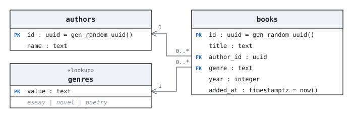

Ocaml postgrest client
======================

A type-safe postgrest client written for OCaml

This was written as part of my `Herbier`_ project, then pulled into its own repo.

Usage
-----

imagine you have the following database schema

   
    Example database schema

Then ocaml-postgrest will allow you to write code like follows:

.. code-block:: ocaml

    open Tables
    module Pg = Postgrest.Unix
    module Filter = Postgrest.Filter.Syntax
    module Row = Postgrest.Row.Syntax
  
    type book = {
        title: string;
        author_name: string;
    }

    let conn = Postgrest.Client.supabase_conn my_url ~apikey ~token

    let bookrow = 
        let open Row in 
        let+ title = col Books.title
        (*author name should be fetched through resource embedding*)
        and+ author_name = rel Books.author (col Authors.name)
        in {title; author_name}

    (*simple query*)
    let mybook: (book, Pg.error) result = Pg.select conn 
        (One bookrow)  (*selects a single row*)
        Filter.(Books.id = v "8d0c6a1e-5b7f-4c3a-9e2d-1f4b6a8c0e3d")  (*WHERE clause*)
        Books.table (* FROM clause *)

    (*more complex query*)
    let books_from_2026_and_25: (book list, Pg.error) result = Pg.select conn 
        (Many bookrow) 
        Filter.(Books.year = any [2025;2026]) 
        Books.table

    (*remove*)
    let result: (unit, Pg.error) result = Pg.delete conn
        ~returning:Zero (*don’t return deleted rows*)
        Filter.(Books.author_id = v duplicated_author_id)
        Books.table
   

.. _Herbier: https://github.com/tbrugere/herbier

.. 
